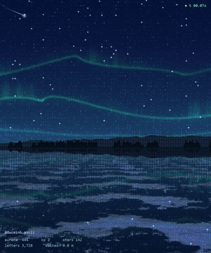

# AURORA IN ASCII

*An ASCII animation by [@dwcminh.ascii](https://instagram.com/dwcminh.ascii) (2026)*



## The idea

A frozen lake far in the north, at night, with nobody on it but you. A star falls as you come in
and the arc over the far shore flares at once into curtains of green light, their rays shooting up
the sky, the black ice giving them back upside down. You glide slowly out over the ice, looking
straight ahead, past drifts of snow and white cracks. Every couple of seconds a surge runs along
the curtains, each one in its own colours: a white flash, a pink hem, a violet crown, a crimson
crown, a blue hem, then pink and crimson together, violet and blue together. The snow takes on
the colour, and more stars fall. Then the storm quietens back into the arc. The end is the
beginning, so it loops for ever.

## How it's made

- **Light first, letters second:** the whole frame is painted first (sky, light, ice and snow), and only then does every cell get a letter that suits what lies under it.
- **Curtains of rays:** the aurora is built from rays that shoot up the sky, and each surge gives the curtains a new set of colours.
- **A mirror of ice:** the black ice gives the sky back upside down, and the snow picks up the colour of each surge.
- **Seamless loop:** the last frame meets the first, so it plays for ever without a jump.
- **Rendering:** a fine character grid, one letter per cell, with a soft glow.

Built with Python, NumPy and pygame-ce.

## Run it

```
pip install -r requirements.txt
python aurora.py
```

Keys: `Space` pause · `R` restart · `S` save a screenshot · `Esc` exit

## Using this code

The source is free for personal use. If you post something you made with it, a mention of
@dwcminh.ascii would be appreciated. The full terms are in LICENSE.txt.

---

Made by [@dwcminh.ascii](https://instagram.com/dwcminh.ascii) on Instagram.
The images and video in this folder belong to @dwcminh.ascii. Please ask before reusing them.
