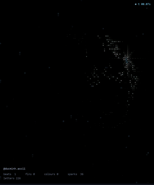

# THE BETTA IN ASCII

*An ASCII animation by [@dwcminh.ascii](https://instagram.com/dwcminh.ascii) (2026)*



## The idea

A fighting fish, all veils, drawn out of nothing. It begins as a single spark in the dark water.
A bare body grows out of it, from the nose back to the tail, while tiny plankton spiral in to the
edge that is being drawn. Then the fins come one at a time, each growing out of the body: the
tail fans open, the long fins rise along the back and fall along the belly, two thin ribbons drop
underneath, and each one flashes white the moment it is finished. Before it is quite whole the
fish is already swimming: it rises with its nose up, turns round with the veils sweeping after
it, dives, and turns again. Then the colours start. On every beat a wave runs from the gills out
to the edge of every fin and leaves the whole fish in new colours, and the tail throws off a ring
of glints. The last two beats go off like fireworks.

## How it's made

- **One wave for the whole fish:** a single slow wave travels down the body and out through every fin to the hem, so the veils follow the tail like silk.
- **Folds that catch the light:** the fins are shaded across their folds, so bright and dark bands travel along them as they move.
- **Growing from nothing:** each part has its own moment to appear and grows out of what is already drawn, never popping in.
- **Picking characters:** outlines follow the shape's edge, solid areas are filled with letters chosen by brightness.
- **Rendering:** a fine character grid drawn with a soft double glow and fading trails.

Built with Python, NumPy and pygame-ce.

## Run it

```
pip install -r requirements.txt
python betta.py
```

Keys: `Space` pause · `R` restart · `S` save a screenshot · `Esc` exit

## Using this code

The source is free for personal use. If you post something you made with it, a mention of
@dwcminh.ascii would be appreciated. The full terms are in LICENSE.txt.

---

Made by [@dwcminh.ascii](https://instagram.com/dwcminh.ascii) on Instagram.
The images and video in this folder belong to @dwcminh.ascii. Please ask before reusing them.
