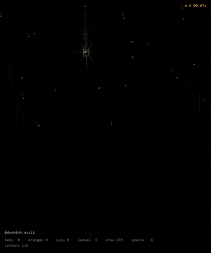

# CAPYBARA IN ASCII

*An ASCII animation by [@dwcminh.ascii](https://instagram.com/dwcminh.ascii) (2026)*



## The idea

A capybara in a hot spring on a winter night, an orange on its head. Snow is falling, steam curls
up off the water and leaves come drifting down the whole time. It begins with the orange: a spark
falls out of the dark, swells into an orange and drops into the black water. Bubbles come up, and
then so does something else, right under it: two ears, a broad brown crown with the orange sitting
on top, eyes, the great square snout, water streaming off it and its reflection rising to meet it.
It shakes the water off its ears and opens its eyes. After that it only floats there, bobbing,
while things happen to it: yuzu drop into the water all round it, more oranges land on the first,
fireworks go off over the water and a kumquat crowns the stack. It does not mind at all: in the
middle of the fireworks it gives an enormous yawn, big front teeth and all, and dozes off while the
floating yuzu light up like lanterns.

## How it's made

- **Soft solids:** the capybara is a few rounded shapes melted together into one body, and its skin is a cloud of points pulled onto that surface.
- **Solid letters with outlines:** every cell shows the nearest point, filled with letters by how bright it is and outlined where the shape ends.
- **A real yawn:** below the line of its mouth the jaw swings down on a hinge, showing the tongue and the big front teeth hidden inside.
- **The hot spring:** the water gives everything back upside down and wavering; snow, steam and falling leaves never stop.
- **Rendering:** a fine character grid, one letter per cell, with a soft glow.

Built with Python, NumPy and pygame-ce.

## Run it

```
pip install -r requirements.txt
python capybara.py
```

Keys: `Space` pause · `R` restart · `S` save a screenshot · `Esc` exit

## Using this code

The source is free for personal use. If you post something you made with it, a mention of
@dwcminh.ascii would be appreciated. The full terms are in LICENSE.txt.

---

Made by [@dwcminh.ascii](https://instagram.com/dwcminh.ascii) on Instagram.
The images and video in this folder belong to @dwcminh.ascii. Please ask before reusing them.
