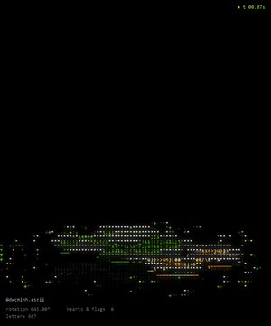

# DUO IN ASCII

*An ASCII animation by [@dwcminh.ascii](https://instagram.com/dwcminh.ascii) (2026), fan art of the Duolingo owl*



## The idea

The green owl, sitting on a shiny floor with its feet out front and its famous round behind
sticking out at the back. It builds up from the floor to the tips of its ears, turned side-on
and giving you that sideways look. Once it is complete it winks and confetti flies, then it
starts to turn. Hearts and flags from all over the world float up, a streak flame counts up to
365, the behind gives a little shake as it swings past, and when the owl faces you again it
winks once more. Its eyes stay on you the whole time.

## How it's made

- **The body:** a 3D shape made of points: a rounded body with the ears pulled up out of its top corners, two big cheeks behind, wings, feet, a beak and tufts above the eyes.
- **The face:** lids, brows and the smirk are strokes drawn on the body. The lids move for blinks and winks, and the pupils slide so the owl always looks at the camera.
- **Picking characters:** strokes use the character that follows their direction (`- / | \`). Body parts get an outline wherever they meet empty space or another part, and are filled with letters chosen by brightness.
- **Extras:** hearts and flags that pop in white and cool to their colours, confetti strips that spin as they fall, a flickering flame with a rolling counter, a faint reflection in the floor.
- **Rendering:** a character grid drawn with a soft double glow and fading trails.

Built with Python, NumPy and pygame-ce.

## Run it

```
pip install -r requirements.txt
python duo_owl.py
```

Keys: `Space` pause · `R` restart · `S` save a screenshot · `Esc` exit

## Using this code

The source is free for personal use. If you post something you made with it, a mention of
@dwcminh.ascii would be appreciated. The full terms are in LICENSE.txt.

---

Made by [@dwcminh.ascii](https://instagram.com/dwcminh.ascii) on Instagram.
The images and video in this folder belong to @dwcminh.ascii. Please ask before reusing them.

Duo and Duolingo are trademarks of Duolingo, Inc. This is unofficial fan art, not made with or endorsed by Duolingo.
