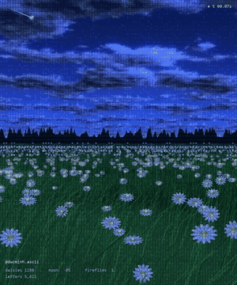

# FIELD IN ASCII

*An ASCII animation by [@dwcminh.ascii](https://instagram.com/dwcminh.ascii) (2026)*



## The idea

A field of daisies at the blue hour, with nobody in it and heavy cloud over the moon. A star falls
as you come in, and a second later the cloud parts, the moon comes out and the whole field
brightens. The wind runs through the thick grass in waves and the daisies nod as it passes, while
you glide slowly forward, low, among them. More stars fall and fireflies come up out of the grass.
Then the cloud closes over the moon again and the field sinks back into blue dusk, the fireflies
bright in it. The end is the beginning, so it loops for ever.

## How it's made

- **Light first, letters second:** the whole frame is painted first (sky, cloud, grass and flowers), and only then does every cell get a letter that suits what lies under it, a little brighter than its ground.
- **Wind in the grass:** waves run through the grass and the daisies nod as each one passes.
- **Seamless loop:** the last frame meets the first, so it plays for ever without a jump.
- **Rendering:** a fine character grid, one letter per cell, with a soft glow.

Built with Python, NumPy and pygame-ce.

## Run it

```
pip install -r requirements.txt
python field.py
```

Keys: `Space` pause · `R` restart · `S` save a screenshot · `Esc` exit

## Using this code

The source is free for personal use. If you post something you made with it, a mention of
@dwcminh.ascii would be appreciated. The full terms are in LICENSE.txt.

---

Made by [@dwcminh.ascii](https://instagram.com/dwcminh.ascii) on Instagram.
The images and video in this folder belong to @dwcminh.ascii. Please ask before reusing them.
