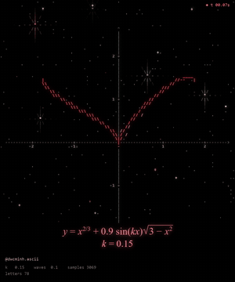

# THE HEART IN ASCII

*An ASCII animation by [@dwcminh.ascii](https://instagram.com/dwcminh.ascii) (2026)*



## The idea

You have probably seen this graph shared around Valentine's Day:

    y = x^(2/3) + 0.9 sin(kx) sqrt(3 - x^2)

Here it is rebuilt from text characters only. With k = 0 you just get a V sitting on the axes.
Push k toward 100 and the sine term oscillates quicker and quicker, always trapped inside a
heart-shaped envelope, until the lines pack so tightly that they merge into one solid red heart.
When k reaches 100, a bright white wave rolls over the heart and throws off a burst of sparks.

## How it's made

- **Sampling:** for each frame the curve is sampled finely at the current k (0 → 100).
- **Picking characters:** every sample is drawn with the stroke that matches the curve's slope on screen: `/`, `|`, `\` or `-`.
- **Filling in:** once the oscillations get dense, crowded cells switch from thin strokes to solid letters, so the outline turns into a filled shape.
- **Finale:** at k = 100 a white wave crosses the heart, sparks fly out, and small glints keep flickering on its surface.
- **Rendering:** everything lives on a character grid, drawn with a soft double glow and fading trails.

Built with Python, NumPy and pygame-ce.

Techniques used: curve sampling that adapts to the curve's speed, slope-based character choice,
density-based shading, sparks with drag and gravity, double-layer glow, fading trails.

## Run it

```
pip install -r requirements.txt
python heart.py
```

Keys: `Space` pause · `R` restart · `S` save a screenshot · `Esc` exit

## Using this code

The source is free for personal use. If you post something you made with it, a mention of
@dwcminh.ascii would be appreciated. The full terms are in LICENSE.txt.

---

Made by [@dwcminh.ascii](https://instagram.com/dwcminh.ascii) on Instagram.
The images and video in this folder belong to @dwcminh.ascii. Please ask before reusing them.
