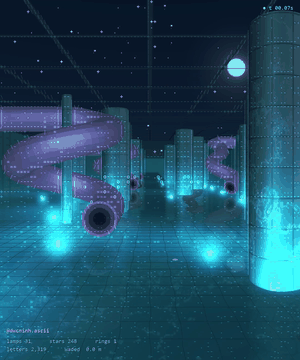

# POOLROOMS IN ASCII

*An ASCII animation by [@dwcminh.ascii](https://instagram.com/dwcminh.ascii) (2026)*



## The idea

A low hall of cream tiles, flooded wall to wall, at night, with nobody in it. The lamps under the
water are on and the pool glows turquoise, and the light it throws crawls up the round tiled
pillars that stand about in it wherever they please. Two lavender water slides come down into the
water: the one on the left winds round its post, the one on the right snakes down from between
the windows. The roof is glass on a grid of steel, and through it you see the night sky, the moon
and the stars, all of them given back by the water. As you come in a star falls across the roof
and through the pool. You glide slowly on under the passing frames while the moon and the stars
stay where they are. Drops fall from the roof, each one spreading rings, and more stars fall. The
end is the beginning, so it loops for ever.

## How it's made

- **Painted in layers:** soft planes drawn at a fifth of the size, and the pillars as smooth pictures at full size.
- **The water is the hall upside down:** the whole hall is flipped and rippled row by row to make the pool.
- **Letters last:** once the picture is painted, every cell gets a letter that suits what lies under it, a little brighter than its ground.
- **Seamless loop:** the last frame meets the first, so it plays for ever without a jump.
- **Rendering:** a fine character grid, one letter per cell, with a soft glow.

Built with Python, NumPy and pygame-ce.

## Run it

```
pip install -r requirements.txt
python poolrooms.py
```

Keys: `Space` pause · `R` restart · `S` save a screenshot · `Esc` exit

## Using this code

The source is free for personal use. If you post something you made with it, a mention of
@dwcminh.ascii would be appreciated. The full terms are in LICENSE.txt.

---

Made by [@dwcminh.ascii](https://instagram.com/dwcminh.ascii) on Instagram.
The images and video in this folder belong to @dwcminh.ascii. Please ask before reusing them.
