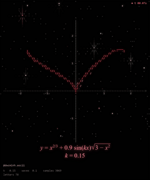
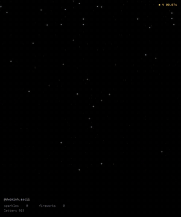
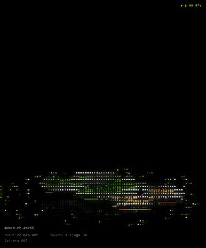
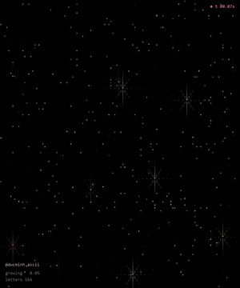
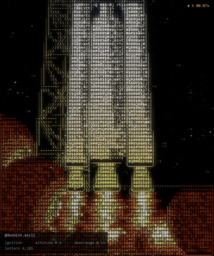
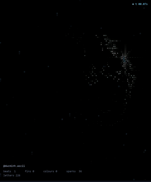

# dwcminh.ascii

Animations made entirely of text characters, written in Python.
These are the source files behind the reels on Instagram [@dwcminh.ascii](https://instagram.com/dwcminh.ascii).

## Artworks

<table>
  <tr>
    <td align="center" valign="top">
      <a href="HEART/"></a><br>
      <a href="HEART/"><b>HEART</b></a>
    </td>
    <td align="center" valign="top">
      <a href="EIFFEL-TOWER/"></a><br>
      <a href="EIFFEL-TOWER/"><b>EIFFEL TOWER</b></a>
    </td>
    <td align="center" valign="top">
      <a href="DUO-OWL/"></a><br>
      <a href="DUO-OWL/"><b>DUO</b></a>
    </td>
  </tr>
  <tr>
    <td align="center" valign="top">
      <a href="ROSE-BOUQUET/"></a><br>
      <a href="ROSE-BOUQUET/"><b>ROSE BOUQUET</b></a>
    </td>
    <td align="center" valign="top">
      <a href="UNIVERSE/"></a><br>
      <a href="UNIVERSE/"><b>UNIVERSE</b></a>
    </td>
    <td align="center" valign="top">
      <a href="BETTA-FISH/"></a><br>
      <a href="BETTA-FISH/"><b>BETTA FISH</b></a>
    </td>
  </tr>
</table>

## Running a piece

Every folder can be run on its own:

```
cd HEART
pip install -r requirements.txt
python heart.py
```

## Support

If you enjoy these pieces and want to see more, you can buy me a coffee on Ko-fi:

[](https://ko-fi.com/dwcminhascii)

## Terms

The code is free for personal, non-commercial use. The full terms are in [LICENSE.txt](LICENSE.txt);
each artwork folder carries a copy of the same terms.
Please don't use the code or the artwork with AI tools (feeding it to AI models, training on it,
or having an AI rework it).
If you share something you made with it, please tag @dwcminh.ascii.

The images and videos belong to @dwcminh.ascii. Please ask before reusing them.
