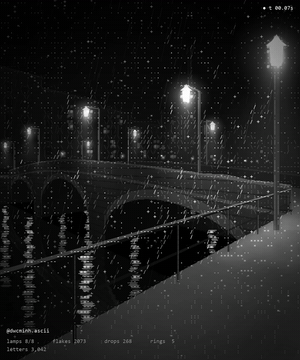

# SLEET IN ASCII

*An ASCII animation by [@dwcminh.ascii](https://instagram.com/dwcminh.ascii) (2026)*



## The idea

An old stone bridge over the river in the middle of town, on a winter night, black and white like
an old film, with nobody about. You stand still on the pavement by the river wall; the bridge
crosses the water in front of you on a slant, on three arches, with lamps along both its parapets.
Snow lies on everything, and more is coming down, thick, with rain in it. Every lamp is lit, each
laying a long broken line of light down the water. Now and then a lamp buzzes, a car crosses the
bridge towards you, a gust drives the snow sideways. At the end the lamps go out: the far bank
first, then the bridge from its far end, the one beside you last.

## How it's made

- **Light first, letters second:** stone, snow, water and lamplight are painted first, in greys, and only then does every cell get a letter that suits what lies under it.
- **A real scene:** the bridge, its arches, the houses across the river and the lamps are found by following rays into the scene, so the light falls where it should.
- **The river:** every lamp lays a broken line of light down the water.
- **The weather:** snow with rain in it, and gusts that drive it sideways.
- **Rendering:** a character grid, one letter per cell, with a soft glow.

Built with Python, NumPy and pygame-ce.

## Run it

```
pip install -r requirements.txt
python sleet.py
```

Keys: `Space` pause · `R` restart · `S` save a screenshot · `Esc` exit

## Using this code

The source is free for personal use. If you post something you made with it, a mention of
@dwcminh.ascii would be appreciated. The full terms are in LICENSE.txt.

---

Made by [@dwcminh.ascii](https://instagram.com/dwcminh.ascii) on Instagram.
The images and video in this folder belong to @dwcminh.ascii. Please ask before reusing them.
