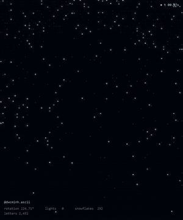

# SNOW GLOBE IN ASCII

*An ASCII animation by [@dwcminh.ascii](https://instagram.com/dwcminh.ascii) (2026)*



## The idea

A snow globe with a log cabin inside, out in the snow under the stars. The wooden stand is turned
first, then two strands of light swirl up round it like tinsel and leave the glass behind them,
bursting like a star at the top, and the globe fills with snow. The cabin goes up log by log, the
roof goes on, then the chimney; pines grow round it, the windows and the door pop in white-hot and
cool, and a snowman pops up by the door. The windows light up warm, fairy lights come on along the
eaves one by one and smoke starts to rise. Then the globe is shaken: it rocks, the snow swirls up
and settles again, slowly, on the roof and the trees.

## How it's made

- **Built in 3D:** the stand, every log, the roof boards, the chimney stones, the pines and the snowman are made of points in space; every cell shows the nearest one.
- **Drawn as it is built:** each part grows in its turn, flashes white as it appears and cools to its own colour.
- **The glass:** the swirl of light leaves the glass behind it; on the shake hundreds of flakes are thrown up and settle again.
- **Rendering:** a fine character grid, one letter per cell, with a soft glow.

Built with Python, NumPy and pygame-ce.

## Run it

```
pip install -r requirements.txt
python snow_globe.py
```

Keys: `Space` pause · `R` restart · `S` save a screenshot · `Esc` exit

## Using this code

The source is free for personal use. If you post something you made with it, a mention of
@dwcminh.ascii would be appreciated. The full terms are in LICENSE.txt.

---

Made by [@dwcminh.ascii](https://instagram.com/dwcminh.ascii) on Instagram.
The images and video in this folder belong to @dwcminh.ascii. Please ask before reusing them.
