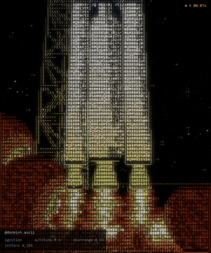

# UNIVERSE IN ASCII

*An ASCII animation by [@dwcminh.ascii](https://instagram.com/dwcminh.ascii) (2026)*



## The idea

A single continuous shot that goes from a rocket's engines all the way out to the galaxy.
It starts tight on the engines, already burning, the camera shaking as it climbs the rocket
on its launch tower before sunrise. The rocket lifts off and the camera rides along: the pad
drops away, the lights along the coast spread out underneath, the boosters fall off. Then the
camera lets go and backs away, further and further. The rocket shrinks to a spark trailing a
thin line of smoke over the curve of the planet, the sun rises over the horizon, and the whole
Earth comes into view, half daylight, half city lights. Still the camera keeps going: the Earth
becomes a small ball, the planets appear one by one in a line from the sun, the sun turns into
one star among many rushing past, and finally the whole galaxy is in frame, with a small spark
in one of its arms marking where it all began.

## How it's made

- **Ray tracing in letters:** every character on screen is one ray shot into a 3D scene. The rocket is built from a few cones, the smoke from spheres, and the Earth is one large sphere with a world map wrapped around it.
- **One camera move:** the camera follows a single path from the launch pad to the edge of the galaxy, with no cuts.
- **Scale:** each stage (pad, coast, orbit, planets, stars, galaxy) takes over from the last as the camera pulls back.
- **Picking characters:** outlines follow the shape's edge, solid areas are filled with letters chosen by brightness.
- **Rendering:** a character grid drawn with a soft double glow and fading trails.

Built with Python, NumPy and pygame-ce.

## Run it

```
pip install -r requirements.txt
python universe.py
```

Keys: `Space` pause · `R` restart · `S` save a screenshot · `Esc` exit

## Using this code

The source is free for personal use. If you post something you made with it, a mention of
@dwcminh.ascii would be appreciated. The full terms are in LICENSE.txt.

---

Made by [@dwcminh.ascii](https://instagram.com/dwcminh.ascii) on Instagram.
The images and video in this folder belong to @dwcminh.ascii. Please ask before reusing them.
